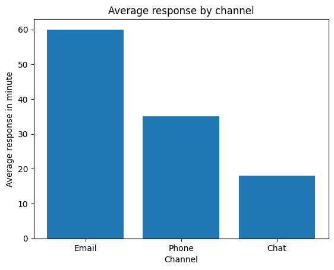
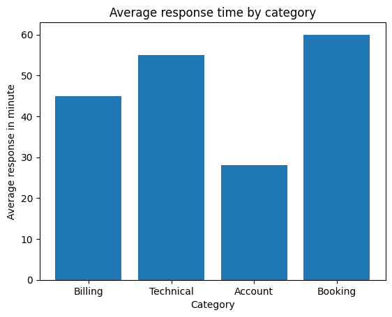
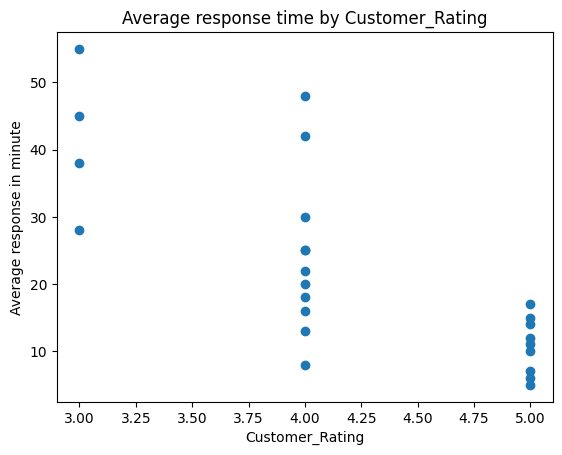

# Customer Enquiry Response Analysis

**Portfolio project \| Python, Pandas, Matplotlib**

## Project overview

This project analyzes a fictional customer enquiry log to understand
response times, resolution performance, and customer ratings. The goal
is to identify service bottlenecks and recommend practical improvements
to customer experience.

> **Dataset note:** All 30 enquiry records are fictional and were
> created for learning and portfolio demonstration. The findings should
> not be interpreted as results from a real company.

## Objectives

-   Measure overall customer enquiry response and resolution
    performance.
-   Compare average response times across communication channels and
    enquiry categories.
-   Explore the relationship between response time and customer ratings.
-   Compare average resolution times across enquiry categories.
-   Translate findings into actionable service-improvement
    recommendations.

## Tools and methods

-   **Python** for analysis
-   **Pandas** for data inspection, cleaning, grouping, and summary
    statistics
-   **Matplotlib** for charts
-   **Google Colab** for notebook-based analysis

## Dataset

The dataset contains 30 records and these fields:

  -----------------------------------------------------------------------
  Field                               Description
  ----------------------------------- -----------------------------------
  `Enquiry_ID`                        Unique enquiry identifier

  `Category`                          Billing, Technical, Account, or
                                      Booking

  `Channel`                           Chat, Email, or Phone

  `Response_Time_Min`                 Minutes before the customer
                                      received a response

  `Resolution_Status`                 Resolved or Pending

  `Resolution_Time_Hours`             Hours taken to resolve an enquiry

  `Customer_Rating`                   Customer rating, where available

  `Agent`                             Fictional agent assigned to the
                                      enquiry
  -----------------------------------------------------------------------

## Data quality checks

-   **30 records** were reviewed.
-   **0 duplicate rows** were identified.
-   Six pending enquiries had missing resolution times and customer
    ratings.
-   Missing ratings were excluded when analyzing the relationship
    between response time and customer ratings; the original dataset was
    retained.

## Key findings

  Measure                                          Result
  --------------------------------------- ---------------
  Total enquiries                                      30
  Resolved enquiries                                   24
  Resolution rate                                     80%
  Average response time                     24.17 minutes
  Average rating for resolved enquiries          4.21 / 5
  Average response time --- Email            40.3 minutes
  Average response time --- Chat             10.6 minutes
  Average response time --- Booking         30.29 minutes
  Average response time --- Account         15.43 minutes
  Average resolution time --- Technical        1.75 hours
  Average resolution time --- Account           1.00 hour

### Interpretation

1.  **Email had the slowest average response time** at 40.3 minutes,
    while Chat was fastest at 10.6 minutes.
2.  **Booking enquiries had the longest average initial response time**
    at about 30.29 minutes; Account enquiries had the shortest at about
    15.43 minutes.
3.  **Technical enquiries took the longest to resolve**, averaging 1.75
    hours. Account enquiries were resolved fastest, averaging 1 hour.
4.  The scatter plot suggested that **longer response times tended to be
    associated with lower customer ratings**. This is an association,
    not proof that response time alone caused lower ratings.
5.  The overall resolution rate was 80%, meaning six of the 30 enquiries
    remained pending in this fictional dataset.

## Visualizations

The notebook includes: 1. Average response time by communication
channel. 2. Average response time by enquiry category. 3. Response time
versus customer rating.
### 1. Average Response Time by Channel

### 2. Average Response Time by Category

### 3. Response Time vs Customer Rating

## Recommendations

-   **Prioritize technical support improvements:** provide
    troubleshooting guides, targeted agent training, and clear
    escalation paths.
-   **Review email handling:** examine workload and routing, and set
    measurable response-time targets.
-   **Improve booking enquiry routing:** ensure booking requests reach
    the appropriate team quickly.
-   **Monitor customer experience:** review response times and customer
    ratings together over time.
-   **Follow up on pending cases:** track unresolved enquiries and
    investigate recurring causes of delay.

## Conclusion

This project demonstrates a basic end-to-end data analysis workflow:
inspecting a dataset, checking data quality, calculating summary
statistics, visualizing service patterns, and turning findings into
recommendations. In a real organization, the next step would be to
validate these patterns using actual service data and compare
performance over a longer period.

## Files

-   `Customer_Enquiry_Response_Analysis.ipynb` --- analysis notebook
    (upload this file to the repository).
-   `README.md` --- project overview, findings, and recommendations.
-   `Customer_Enquiry_Response_Analysis_Report.docx` --- optional
    downloadable report.

## Reproducibility

Open the notebook in Google Colab or Jupyter and run the cells in order.
The data is fictional and is created within the notebook.
